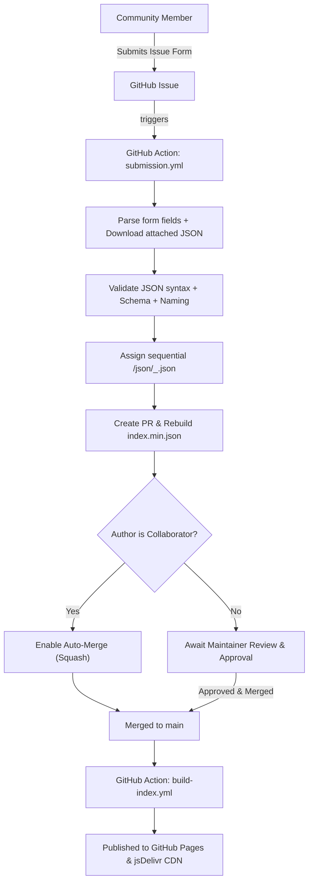

# kytyps5-modules

Central, modular repository for **KytyPS5** patches, cheats, and game configuration presets.

---

## 📁 Repository Structure

```text
kytyps5-modules/
├── patches/json/       # Game patches (memory byte patches, timing/FPS unlocks, resolution mods)
├── cheats/json/        # Game cheats (trainers, infinite health/items)
├── configs/json/       # Optimized emulator settings presets per game
├── scripts/            # Automation scripts for index generation, validation, and submission
├── index.json          # Formatted global catalog
└── index.min.json      # Minified global catalog for fast CDN distribution
```

---

## 🏷️ Filename Convention

All files strictly follow this standard naming convention:

$$\text{Format: } \texttt{<TitleID>\_<Version>\_<Game\_Name>\_<Index>.json}$$

```regex
\A(?<id>[A-Z]{4}\d{5})_(?<version>\d{2}_\d{3}_\d{3})_(?<game_name>[A-Za-z0-9]+(?:_[A-Za-z0-9]+)*)_(?<index>\d+)\.json\z
```

- **Title ID**: Bare uppercase PS5 game Title ID (e.g. `PPSA01325`).
- **Version**: Game version with underscores instead of dots (e.g. `01.905.000` $\to$ `01_905_000`). Entering dots in the version section automatically converts them to underscores.
- **Game Name**: Alphanumeric title with words separated by single underscores (e.g. `Astros_Playroom`).
- **Sequential Index**: Sequential counter (`_1`, `_2`, `_3`...) to handle multiple patches or cheats for the same PPSA and version without filename collisions.

### Examples:
- `patches/json/PPSA01325_01_905_000_Astros_Playroom_1.json`
- `patches/json/PPSA01325_01_905_000_Astros_Playroom_2.json`
- `patches/json/PPSA28997_01_008_001_God_of_War_Sons_of_Sparta_1.json`

---

## 🚀 How to Contribute

All contributions are submitted via **GitHub Issue Forms**:

1. Navigate to **Issues** $\to$ **New Issue**.
2. Select **Patch Submission**, **Cheat Submission**, or **Config Submission**.
3. Fill in the Title ID, Game Version (dots like `01.905.000` are automatically converted to underscores `01_905_000`), Game Name, and Title.
4. Drag and drop your `.json` file into the attachment field (or paste the JSON directly).
5. Submit the issue.

The automated submission workflow will:
- Parse and validate the form data and attached JSON.
- Automatically convert any version dots to underscores.
- Assign the next available sequential filename.
- Open a Pull Request on branch `submission/<type>-<ppsa>-<version>-i<issue_number>`.

---

## 🔄 Automated Review & Merge Workflow



- **Collaborators**: PRs opened from maintainer submissions are validated and automatically scheduled for auto-merge.
- **Community Submissions**: PRs are opened for maintainer review, preventing unverified or malformed code from landing directly on `main`.

---

## 🌐 CDN & Client Application Integration

The catalog is distributed dynamically via **GitHub Pages** (immediate updates) and accelerated via **jsDelivr CDN** (global edge caching). No repository owner is hardcoded.

### Base URLs:
- **GitHub Pages (Dynamic Catalog with immediate ETag updates)**:
  `https://<owner>.github.io/kytyps5-modules`
- **jsDelivr CDN (Fast Global Edge Caching for static assets)**:
  `https://cdn.jsdelivr.net/gh/<owner>/kytyps5-modules@main`

---

### TypeScript Type Definitions

```typescript
export interface CatalogIndex {
  version: number;
  catalogHash: string; // 64-char SHA-256 hash of entire catalog
  updatedAt: string;   // ISO-8601 timestamp
  patches: Record<string, ModuleEntry[]>; // Keyed by Title ID (e.g. "PPSA01325")
  cheats: Record<string, ModuleEntry[]>;
  configs: Record<string, ModuleEntry[]>;
}

export interface ModuleEntry {
  id: string;          // PS5 Title ID, e.g. "PPSA01325"
  version: string;     // Normalized version with underscores, e.g. "01_905_000"
  gameName: string;    // Human-readable game title
  index: number;       // Sequential counter (1, 2, ...)
  title: string;       // Mod or patch title
  description: string; // Patch notes or usage instructions
  author: string;      // Submitter or creator
  path: string;        // Relative path: "patches/json/<filename>.json"
  sha256: string;      // SHA-256 hash of canonical LF content
  size: number;        // Byte length
}

export interface MemoryPatch {
  offset: string;      // Hex address, e.g. "0x73eb993"
  on: string;          // Replacement hex bytes
  off: string;         // Original hex bytes
}

export interface ModItem {
  name: string;
  enabled: boolean;
  memory?: MemoryPatch[];
}

export interface PatchModule {
  id: string;
  name: string;
  version: string;     // e.g. "01_905_000"
  process?: string;    // Target executable, e.g. "eboot.bin"
  source_sha256?: string;
  mods?: ModItem[];
}
```

---

### Client Implementation Example

```typescript
import { createHash } from "node:crypto";

class KytyModuleManager {
  private repoOwner: string;
  private cachedEtag: string | null = null;
  private catalog: CatalogIndex | null = null;

  constructor(repoOwner: string = "KytyPS5") {
    this.repoOwner = repoOwner;
  }

  get pagesBaseUrl(): string {
    return `https://${this.repoOwner}.github.io/kytyps5-modules`;
  }

  get cdnBaseUrl(): string {
    return `https://cdn.jsdelivr.net/gh/${this.repoOwner}/kytyps5-modules@main`;
  }

  /**
   * Fetches the catalog manifest using HTTP ETag caching.
   * If unchanged, the server returns HTTP 304 and cached data is reused.
   */
  async refreshCatalog(): Promise<CatalogIndex> {
    const headers: Record<string, string> = {};
    if (this.cachedEtag) {
      headers["If-None-Match"] = this.cachedEtag;
    }

    const res = await fetch(`${this.pagesBaseUrl}/index.min.json`, { headers });

    if (res.status === 304 && this.catalog) {
      // Catalog unchanged; reuse memory cache
      return this.catalog;
    }

    if (res.ok) {
      this.cachedEtag = res.headers.get("etag");
      this.catalog = (await res.json()) as CatalogIndex;
      return this.catalog;
    }

    throw new Error(`Failed to fetch catalog: HTTP ${res.status}`);
  }

  /**
   * Lazy-loads and verifies a module JSON file on demand.
   */
  async fetchModule(entry: ModuleEntry): Promise<PatchModule> {
    const res = await fetch(`${this.cdnBaseUrl}/${entry.path}`);
    if (!res.ok) {
      throw new Error(`Failed to download ${entry.path}: HTTP ${res.status}`);
    }

    const rawText = await res.text();
    // Normalize to LF before computing SHA-256 to ensure cross-platform hash parity
    const normalizedBytes = Buffer.from(rawText.replace(/\r\n/g, "\n"), "utf8");
    const actualHash = createHash("sha256").update(normalizedBytes).digest("hex");

    if (actualHash !== entry.sha256) {
      throw new Error(
        `Integrity check failed for ${entry.path}! Expected: ${entry.sha256}, Got: ${actualHash}`
      );
    }

    return JSON.parse(rawText) as PatchModule;
  }
}
```

---

## 🛠️ Local Development & Quality Gates

```bash
# Run complete test suite (unit + integration)
npm test

# Validate all module files against schema and naming regex
npm run validate

# Rebuild index.json and index.min.json
npm run build:index

# Run all verification steps in sequence
npm run check
```
