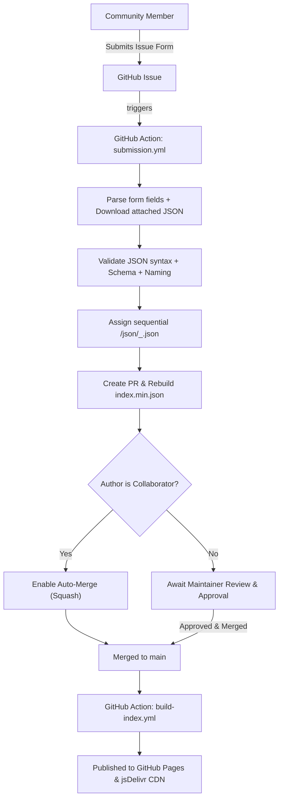

# kytyps5-modules

Central, modular repository for **KytyPS5** patches, cheats, and game configuration presets.

---

## 📁 Repository Structure

```text
kytyps5-modules/
├── patches/json/       # Game patches (memory byte patches, timing/FPS unlocks, resolution mods)
├── cheats/json/        # Game cheats (trainers, infinite health/items)
├── configs/json/       # Optimized emulator settings presets per game
├── scripts/            # Automation scripts for index generation and submission handling
├── index.json          # Formatted global catalog
└── index.min.json      # Minified global catalog for fast CDN distribution
```

---

## 🏷️ Filename Convention

All files strictly follow this naming standard:

$$\text{Format: } \texttt{<TitleID>\_<Version>\_<Game\_Name>\_<Index>.json}$$

```regex
\A(?<id>[A-Z]{4}\d{5})_(?<version>\d{2}_\d{3}_\d{3})_(?<game_name>[A-Za-z0-9]+(?:_[A-Za-z0-9]+)*)_(?<index>\d+)\.json\z
```

- **Title ID**: Bare uppercase PS5 game Title ID (e.g. `PPSA01325`).
- **Version**: Game version with underscores instead of dots (e.g. `01.905.000` $\to$ `01_905_000`).
- **Game Name**: Alphanumeric title with words separated by single underscores (e.g. `Astros_Playroom`).
- **Sequential Index**: Sequential counter (`_1`, `_2`, `_3`...) to handle multiple patches or cheats for the same PPSA and version.

### Examples:
- `patches/json/PPSA01325_01_905_000_Astros_Playroom_1.json`
- `patches/json/PPSA01325_01_905_000_Astros_Playroom_2.json`
- `patches/json/PPSA28997_01_008_001_God_of_War_Sons_of_Sparta_1.json`

---

## 🚀 How to Contribute

All contributions must be submitted via **GitHub Issue Forms**:

1. Go to **Issues** $\to$ **New Issue**.
2. Select **Patch Submission**, **Cheat Submission**, or **Config Submission**.
3. Fill in the Title ID, Game Version, Game Name, and Title.
4. Drag and drop your `.json` file into the attachment field.
5. Submit the issue.

The GitHub Actions submission workflow will automatically:
- Parse and validate the form data and attached JSON.
- Assign the next available sequential filename.
- Open a Pull Request on branch `submission/<type>-<ppsa>-<version>-i<issue_number>`.

---

## 🔄 Automated Review & Merge Workflow



- **Collaborators**: PRs opened from maintainer submissions are validated and automatically squashed and merged.
- **Community Submissions**: PRs are opened for maintainer review, preventing unverified or malformed code from landing directly on `main`.

---

## 🌐 CDN & Client Application Integration

The repository is hosted on **GitHub Pages** and accelerated via **jsDelivr CDN**. No repository owner or URL is hardcoded; client apps resolve URLs dynamically.

### Base URLs:
- **jsDelivr CDN (Fastest Edge Caching)**:
  `https://cdn.jsdelivr.net/gh/<owner>/kytyps5-modules@main/`
- **GitHub Pages**:
  `https://<owner>.github.io/kytyps5-modules/`

### Client Flow:
1. **Startup / Manual Refresh**:
   Client requests `index.min.json` with standard HTTP `If-None-Match: <etag>` headers. If HTTP `304 Not Modified`, the client reuses its cached catalog with zero payload download.
2. **Lazy-loading Modules**:
   When a user clicks on a game in the emulator or launcher, the client looks up `index.patches[titleId]` and lazy-fetches only the specific JSON file referenced by `entry.path`.

```ts
// Example Client Integration
const BASE_URL = `https://cdn.jsdelivr.net/gh/${repoOwner}/kytyps5-modules@main`;

// 1. Fetch catalog with ETag caching
const catalogRes = await fetch(`${BASE_URL}/index.min.json`, {
  headers: cachedEtag ? { "If-None-Match": cachedEtag } : {}
});

if (catalogRes.status === 200) {
  const catalog = await catalogRes.json();
  const etag = catalogRes.headers.get("etag");
  // Update cache...
}

// 2. Fetch specific patch on demand
const patch = await fetch(`${BASE_URL}/${patchEntry.path}`).then(r => r.json());
```

---

## 🛠️ Local Development & Testing

```bash
# Run unit tests
npm test

# Validate all files against schema and naming regex
npm run validate

# Rebuild index.json and index.min.json
npm run build:index
```
